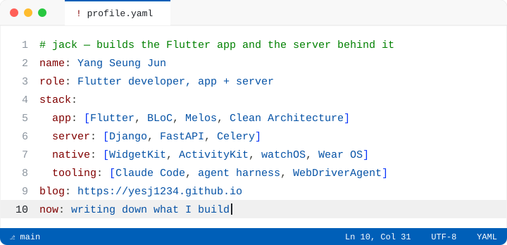

<a href="https://yesj1234.github.io">
  <picture>
    <source media="(prefers-color-scheme: dark)" srcset="assets/profile-dark.svg">
    
  </picture>
</a>

<samp><a href="https://github.com/yesj1234">한국어</a> · English</samp>

### Hi, I'm Seung Jun Yang (jack)

I build Flutter apps and the servers behind them (Django · FastAPI).
I also work on the native surfaces outside Flutter — home screen widgets, Live Activities, Apple Watch —
and build the rules and tools that AI coding agents follow in our team repositories.

My work code is private, so I write about what I build on my blog → **[yesj1234.github.io](https://yesj1234.github.io/about)** (posts are in Korean)

#### Selected work

- **[A zero crash count was not a measurement](https://yesj1234.github.io/posts/ios_crashlytics_zero_crashes)** — After moving iOS dependencies to Swift Package Manager, Crashlytics reported zero iOS crashes for 21 builds. I traced it to a dSYM upload step that failed silently, and made the build stop when the upload fails.
- **[270 ways to debounce a button](https://yesj1234.github.io/posts/bloc_concurrency_refactor)** — Replaced about 270 hand-rolled ways of handling overlapping BLoC events with declarative `bloc_concurrency` transformers.
- **[Starting a Live Activity is not the same as updating one](https://yesj1234.github.io/posts/live_activity_push_to_start)** — Built both the app and the server side, on my own, so the server keeps a Live Activity current while the app is asleep.
- **[Building an AI reviewer, then giving it a blind test](https://yesj1234.github.io/posts/ai_pr_review_skill)** — A PR review skill that covers PRs our review bot skipped; verified with a blind test (zero false positives) and made 52–62% cheaper to run.
- **[Why our Flutter app is split into six packages](https://yesj1234.github.io/posts/flutter_architecture_1_monorepo)** — A five-part series measuring a Melos monorepo with Clean Architecture and BLoC after a year of building on it.

#### Recent posts (in Korean)

<!-- posts:start -->
- [패키지를 6개로 나눠도 경계는 린트가 지킨다](https://yesj1234.github.io/posts/flutter_architecture_1_monorepo) — 2026-11-18
- [일의 단위가 바뀌면 질문도 바뀐다 — 화면 하나에서 에픽 하나로, Flutter 1년 3개월](https://yesj1234.github.io/posts/flutter_first_year_retrospective) — 2026-11-18
- [실패를 값으로 바꾸자, 던져진 실패가 숨기 시작했다](https://yesj1234.github.io/posts/flutter_architecture_3_result) — 2026-11-18
- [구조는 사람보다 AI 가 더 문자 그대로 읽는다 — DI·라우팅·테스트 편](https://yesj1234.github.io/posts/flutter_architecture_5_di_routing_testing) — 2026-11-18
- [계층의 경계는 타입이 바뀌는 자리였다 — 토글 하나를 서버까지 따라가 보기](https://yesj1234.github.io/posts/flutter_architecture_2_data_flow) — 2026-11-18
<!-- posts:end -->

#### Contact

[Blog](https://yesj1234.github.io) · [LinkedIn](https://www.linkedin.com/in/%EC%8A%B9%EC%A4%80-%EC%96%91-859646257/) · juesc007@gmail.com
